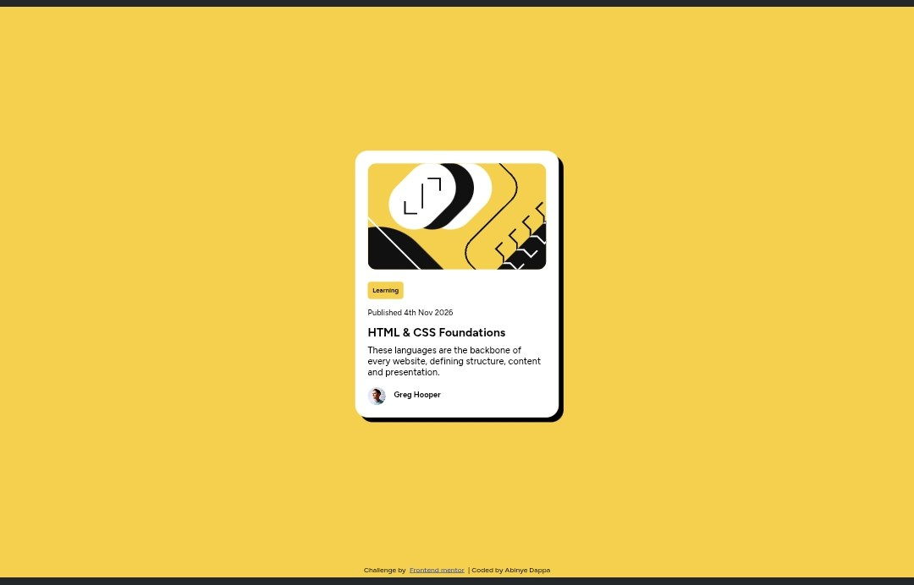

# Blog Preview Card

## Description
This website is a simple blog preview card from frontendmentor to further test my html and css skills.

## Screenshot

## Live site URL
https://dappaabinye-ship-it.github.io/blog_preview_card/

## Aim
A refresher to practice all i've learned in HTML and CSS

## Languages
- HTML
- CSS
- CSS Flexbox

## What I learnt
In this project, I learned how to implement:
- CSS box-shadow property
- CSS :hover pseudo-class property
- How to import fonts from an external source (Google fonts)

## Acknowledgements
FRONTENDMENTOR for this project.
